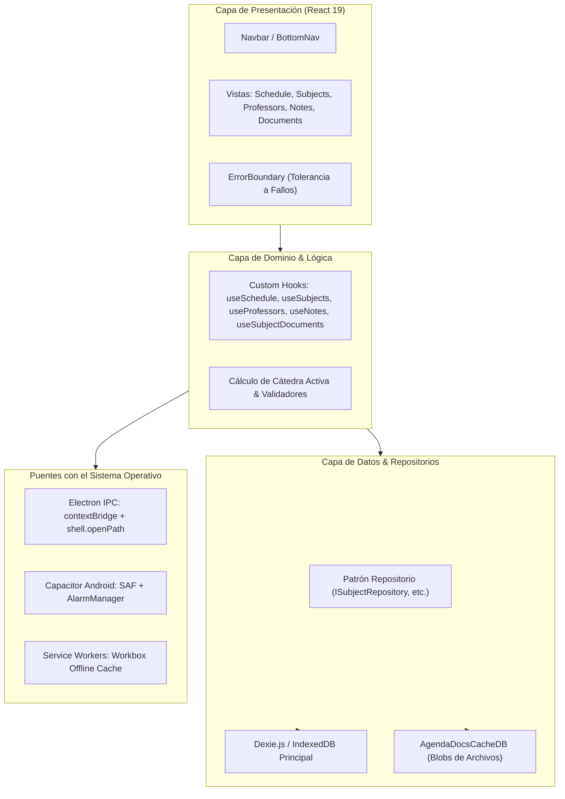

<div align="center">
  

  # 🎓 Agenda Universitaria

  ### *"POR Y PARA LOS ESTUDIANTES"*

  **Progressive Web App (PWA) • Aplicación Móvil Android • Versión Nativa de Escritorio para Windows**
  
  *Diseñada con arquitectura **Offline-First / Local-First**, Clean Architecture y Material Design 3 para la gestión integral de la vida académica universitaria sin depender de conexión a internet ni servidores centralizados.*

  <br />

  [](VERSIONING.md)
  [](LICENSE)
  [](docs/architecture/overview.md)
  [](https://react.dev/)
  [](https://www.typescriptlang.org/)
  [](https://tailwindcss.com/)
  [](https://capacitorjs.com/)
  [](https://www.electronjs.org/)
  [](https://dexie.org/)

</div>

---

## 📑 Tabla de Contenidos

1. [Visión y Principios del Proyecto](#-visión-y-principios-del-proyecto)
2. [Disponibilidad Multiplataforma](#-disponibilidad-multiplataforma)
3. [Módulos y Características Principales](#-módulos-y-características-principales)
4. [Arquitectura de Software (Anti-Vibecoding)](#-arquitectura-de-software-anti-vibecoding)
5. [Guía Rápida de Instalación y Ejecución](#-guía-rápida-de-instalación-y-ejecución)
6. [Estructura del Proyecto](#-estructura-del-proyecto)
7. [Documentación y Recursos](#-documentación-y-recursos)
8. [Autoría y Créditos](#-autoría-y-créditos)

---

## 🌟 Visión y Principios del Proyecto

En el entorno universitario real, los estudiantes enfrentan frecuentemente redes Wi-Fi saturadas, ausencia de señal en ciertas aulas y la necesidad crítica de consultar su horario, salón o apuntes en segundos. Adicionalmente, muchas soluciones comerciales exigen cuentas obligatorias, rastrean datos personales o cobran suscripciones recurrentes.

**Agenda Universitaria** se rige por tres pilares fundamentales:

1. **Privacidad y Soberanía Local (Offline-First):** Tus apuntes, fotos de pizarra, calificaciones y horarios residen exclusivamente en tu dispositivo (mediante transacciones en IndexedDB con Dexie.js). Cero telemetría invasiva, cero analíticas de terceros.
2. **Disponibilidad Incondicional (0ms Latency):** La aplicación no depende de si el campus tiene luz o internet. Abre al instante gracias a Service Workers (PWA) y empaquetados nativos.
3. **Ingeniería Anti-Vibecoding:** Cada pantalla, componente y decisión de diseño responde a patrones de ingeniería formales (Clean Architecture, Feature-First, Error Boundaries resilientes y diseño ergonómico para una sola mano en móviles).

---

## 📱 Disponibilidad Multiplataforma

El mismo núcleo de código frontend está optimizado para tres entornos de distribución:

| Plataforma | Formato de Entrega | Características Nativas | Estado |
| :--- | :--- | :--- | :--- |
| **Navegador Web (PWA)** | Despliegue en **GitHub Pages** | Cacheo con Workbox, instalable como app en Chrome/Safari/Edge, soporte para teclado y ratón. | ✅ Estable (`v1.7.9.12`) |
| **Teléfono Móvil (Android)** | Archivo ejecutable **`.apk`** | Integración con `AlarmManager`, Storage Access Framework (SAF) para respaldos, soporte para Display Cutout (Edge-to-Edge) y botón físico "Atrás". | ✅ Estable (`v1.7.9.12`) |
| **Computadora (Windows PC)** | Instalador **`.exe`** (NSIS) | Ventana nativa con Electron v45, apertura de PDFs/Office con visor predeterminado del SO (`shell.openPath`), sin procesos huérfanos. | ✅ Estable (`v1.7.9.12`) |

---

## 🎯 Módulos y Características Principales

```
┌────────────────────────────────────────────────────────────────────────┐
│                        AGENDA UNIVERSITARIA                            │
├──────────────┬──────────────┬──────────────┬─────────────┬─────────────┤
│  📅 HORARIO  │  📚 MATERIAS │ 👥 PROFESORES│  📝 APUNTES │ 📁 ARCHIVOS │
└──────────────┴──────────────┴──────────────┴─────────────┴─────────────┘
```

### 1. 📅 Horario Académico Inteligente (`schedule`)
- **Detección de Cátedra en Vivo (Hero Card):** Identifica automáticamente si te encuentras en horario de clase en este momento y calcula el tiempo restante para el siguiente bloque lectivo.
- **Vistas Adaptativas Semanal y Diaria:** Selector de 5, 6 o 7 días. La cuadrícula semanal está optimizada para encajar 100% en portátiles con pantallas de **1366x768** o superiores con botones reactivos de desplazamiento horizontal.
- **Modalidades de Cátedra:** Soporta clases presenciales (con aula, pabellón y campus) y clases virtuales (con enlaces directos a Zoom, Microsoft Teams, Meet o Campus Virtual).

### 2. 📚 Plan de Asignaturas & Créditos (`subjects`)
- Catálogo curricular completo con cálculo automático de créditos académicos, bloques de clase semanales y conteo de apuntes asociados.
- Identidad visual cromática personalizable con más de 18 glifos temáticos (código, ingeniería, medicina, leyes, economía, etc.).

### 3. 👥 Directorio Docente & Asesorías (`professors`)
- Directorio de contactos alfabético con búsqueda en tiempo real por nombre, asignatura, cubículo o correo.
- Ficha de asesorías académicas y canales directos para llamadas, correo institucional o mensajería.
- Avatares de alta resolución personalizables.

### 4. 📝 Cuaderno de Apuntes Universitario (`notes`)
- **Editor WYSIWYG Full-Bleed (TipTap):** Lienzo editorial sin bordes distractores, inspirado en Google Docs Mobile.
- **Fotos del Pizarrón Comprimidas:** Captura o sube fotos directo desde la cámara. Las imágenes de 48 MPx se comprimen en GPU a resoluciones web optimizadas para evitar sobrecalentamiento y saturación de memoria.
- **Visor Lightbox Multitáctil:** Zoom interactivo, rotación y previsualización en alta calidad.

### 5. 📁 Centro de Documentos & Enlaces Externos (`documents`)
- Repositorio de diapositivas, sílabos, rúbricas y libros en PDF, DOCX, XLSX y PPTX vinculados a cada asignatura.
- Base de datos secundaria aislada (`AgendaDocsCacheDB`) que almacena los archivos binarios sin ralentizar el horario.
- **Apertura Nativa en el SO:** Al pulsar *"↗ Abrir"* en Windows, el archivo se abre directamente en tu visor favorito (Adobe Acrobat, Word, Foxit Reader); en Android se lanza el selector nativo de apps.

### 6. ⚙️ Ajustes & Estudio de Personalización (`settings`)
- **Motor de Paletas Material You:** 8 combinaciones cromáticas de Google Pixel inyectadas en variables CSS `:root` con conmutación en $\le 1$ ms.
- **Soporte de Temas:** Modo Claro de alto contraste (WCAG $\ge 4.5:1$), Modo Oscuro profundo (`#101418`) y sincronización con el sistema operativo.
- **Copias de Seguridad Atómicas:** Exportación e importación en formato JSON para respaldar toda tu vida universitaria en un archivo portátil.

---

## 🏛️ Arquitectura de Software (Anti-Vibecoding)

El sistema está estructurado bajo **Clean Architecture & Feature-First**:



Para una explicación exhaustiva de las decisiones técnicas y patrones de diseño aplicados, consulta la [Visión Arquitectónica](docs/architecture/overview.md) y los [ADRs (Registros de Decisiones de Arquitectura)](docs/decisions/).

---

## 🚀 Guía Rápida de Instalación y Ejecución

### Prerrequisitos
- **Node.js:** `>= 20.x` (o LTS `22.x`)
- **Git:** `>= 2.40`
- **Java JDK:** `JDK 21` o `JDK 24` *(sólo si deseas compilar para Android)*

### 1. Clonar e Instalar
```bash
git clone https://github.com/TU_USUARIO/Agenda-Universitaria.git
cd "Agenda-Universitaria"
npm install
```

### 2. Ejecutar en Modo Desarrollo
```bash
# Modo Web PWA (Navegador en http://localhost:5173)
npm run dev

# Modo Escritorio (Windows Electron con Hot-Reload)
npm run electron:dev
```

### 3. Compilar Paquetes de Producción
```bash
# Compilar versión Web para GitHub Pages / Hosting
npm run build

# Compilar instalador ejecutable para Windows (.exe)
npm run electron:build

# Compilar paquete Android APK (.apk)
npx cap sync android
$env:JAVA_HOME = "C:\Program Files\Java\jdk-24" # en PowerShell
.\android\gradlew.bat assembleDebug -p android
```

> [!TIP]
> Consulta la guía detallada [SETUP.md](SETUP.md) para configurar el entorno desde cero en una máquina nueva, incluyendo variables de entorno y solución de problemas comunes.

---

## 📂 Estructura del Proyecto

```
Agenda-Universitaria/
├── .github/                 # Workflows de CI/CD (GitHub Pages y validación de PRs)
├── android/                 # Proyecto nativo Android (Capacitor Bridge & Java Plugins)
├── docs/                    # Documentación formal de arquitectura y ADRs
│   ├── architecture/        # Visión arquitectónica y diagramas Mermaid
│   └── decisions/           # Architecture Decision Records (ADRs)
├── electron/                # Proceso principal de Electron (main.cjs, preload.cjs, installer.nsh)
├── public/                  # Íconos vectoriales SVG, logotipos y manifest PWA
├── src/
│   ├── features/            # Módulos organizados por dominio (Feature-First)
│   ├── shared/              # ErrorBoundary, M3Select, base de datos Dexie y hooks globales
│   ├── App.tsx              # Componente raíz con arquitectura Keep-Alive (Tab Retention)
│   └── main.tsx             # Punto de entrada React 19 con ErrorBoundary global
├── CHANGELOG.md             # Historial completo de versiones
├── CONTRIBUTING.md          # Guía de contribución y buenas prácticas
├── LICENSE                  # Licencia de código abierto MIT
├── README.md                # Presentación principal del repositorio
├── SETUP.md                 # Guía de configuración y onboarding en máquinas nuevas
├── VERSIONING.md            # Matriz de versiones multiplataforma
├── package.json             # Manifiesto de dependencias y scripts de construcción
└── vite.config.ts           # Configuración de empaquetado Vite y VitePWA
```

---

## 📚 Documentación y Recursos

* 🛠️ **[SETUP.md](SETUP.md):** Manual completo de instalación del entorno de desarrollo.
* 🏷️ **[VERSIONING.md](VERSIONING.md):** Política de versiones sincronizada entre Web, Android y Windows.
* 📜 **[CHANGELOG.md](CHANGELOG.md):** Registro histórico de todas las versiones publicadas.
* 🤝 **[CONTRIBUTING.md](CONTRIBUTING.md):** Convenciones de commits, estilo de código y flujo de ramas.
* 🏛️ **[Visión Arquitectónica](docs/architecture/overview.md):** Diagramas y diseño de capas del sistema.
* 📝 **[ADRs (Decisiones de Arquitectura)](docs/decisions/):**
  - [ADR-001: Persistencia Offline-First con Dexie.js e IndexedDB](docs/decisions/ADR-001-offline-first-dexie-indexeddb.md)
  - [ADR-002: Estrategia Multiplataforma con Capacitor y Electron](docs/decisions/ADR-002-multiplatform-capacitor-and-electron.md)
  - [ADR-003: Adopción de Material Design 3 y Motor de Paletas Material You](docs/decisions/ADR-003-material-design-3-and-dynamic-theming.md)

---

## 👨‍💻 Autoría y Créditos

* **Autor:** **Jorge I. Barrera V.**
* **Afiliación:** Estudiante de Ingeniería en Software, Universidad de Guayaquil.
* **Eslogan Institucional:** *"POR Y PARA LOS ESTUDIANTES"*
* **Licencia:** Distribuido bajo la [Licencia MIT](LICENSE).
