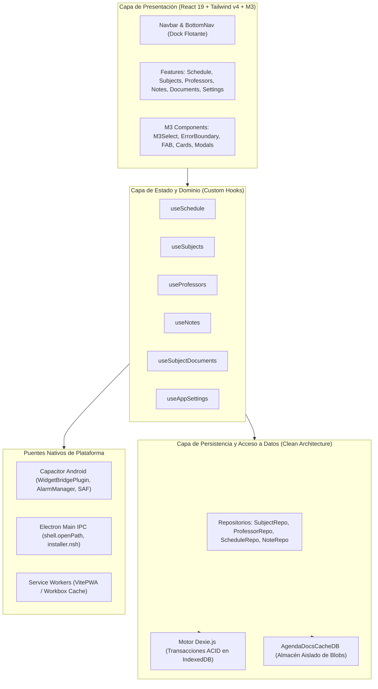

# 🏛️ Visión Arquitectónica del Sistema (Architecture Overview)

## 1. Filosofía de Diseño
**Agenda Universitaria** es una aplicación académica diseñada bajo el principio **Offline-First**, donde el cliente (navegador, dispositivo Android o computadora con Windows) es el propietario y custodio soberano de todos los datos.

---

## 2. Capas del Sistema (Clean Architecture & Feature-First)

1. **Capa de Presentación (UI Components):**
   - Construida con React 19 y TypeScript.
   - Implementa tokens visuales canónicos de **Material Design 3** y el motor de paletas dinámicas **Material You**.
   - Aislamiento y resiliencia mediante `ErrorBoundary` en puntos críticos de renderizado.
   - Patrón **Keep-Alive (Tab Retention)**: Las vistas principales no se destruyen al cambiar de pestaña; permanecen montadas con alternancia de visibilidad CSS (`block` vs `hidden`), garantizando latencia 0 ms y retención del scroll.

2. **Capa de Estado y Dominio (Hooks & Business Logic):**
   - Cada feature (`schedule`, `subjects`, `professors`, `notes`, `documents`, `settings`) expone hooks reactivos (`useLiveQuery`).
   - Sincronización automática de alarmas locales y cálculo de la cátedra activa en tiempo real.

3. **Capa de Persistencia (IndexedDB con Dexie.js):**
   - Transacciones atómicas seguras (`rw`).
   - Sincronización bidireccional entre asignaturas y profesores vinculados.
   - Base de datos secundaria aislada (`AgendaDocsCacheDB`) para almacenar archivos binarios (Blobs de PDFs, fotos de pizarra) sin degradar las consultas sobre metadatos relacionales.

4. **Capa de Puentes Nativos (Multi-Platform Adapters):**
   - **En Android:** Plugins Java personalizados (`WidgetBridgePlugin`) para interactuar con `StorageAccessFramework` (SAF), `AlarmManager` y el intent del sistema para abrir documentos (`ACTION_VIEW`).
   - **En Windows:** Proceso principal de Electron con puente seguro `contextBridge`, delegación de enlaces a navegadores externos y apertura nativa de archivos con `shell.openPath`.
   - **En Web PWA:** Service Worker con Workbox para funcionamiento completo sin conexión y estrategia de cacheo de fuentes y recursos estáticos.
