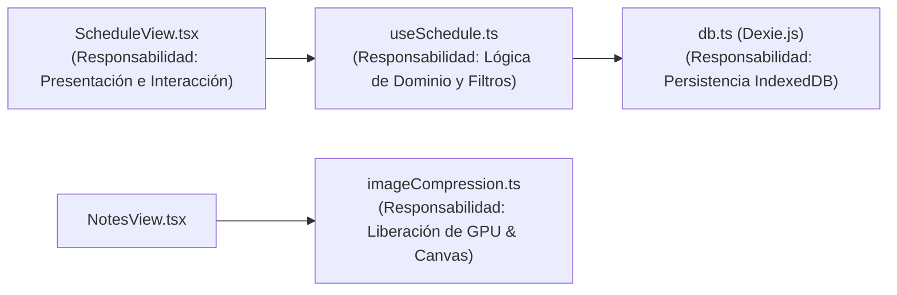
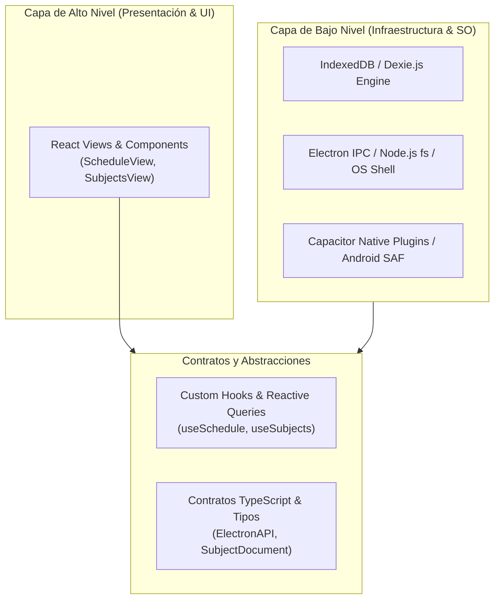

# 🏛️ Aplicación de Principios SOLID en Frontend Moderno (React, TypeScript y Offline-First)

Existe una falsa creencia extendida en la industria de que los **Principios SOLID** (formulados originalmente por Robert C. Martin "Uncle Bob") pertenecen exclusivamente al paradigma de programación orientada a objetos clásico (Java, C# o C++) con clases abstractas y herencia pesada.

En el desarrollo frontend moderno con **React funcional y TypeScript estricto**, los principios SOLID no solo aplican, sino que son la base para construir aplicaciones escalables, mantenibles, testables y libres de acoplamiento. La diferencia radica en su vehículo de implementación: **sustituimos la herencia por composición, las clases abstractas por contratos de tipos (`interfaces`/`types`) y los servicios monolíticos por Custom Hooks e Inyección de Dependencias en capas**.

A continuación se documenta cómo se traduce y aplica cada uno de los 5 principios dentro del código de **Agenda Universitaria**.

---

## 📊 Matriz Comparativa: OOP Clásico vs. Modern React/TypeScript

| Principio | Manifestación Clásica (OOP / Java / C#) | Manifestación en Modern Frontend (React + TS) | Ejemplo en Agenda Universitaria |
| :--- | :--- | :--- | :--- |
| **S** (Single Responsibility) | Clases con un único motivo de cambio. | Desacoplamiento entre Vistas UI, Custom Hooks y Utilidades Puras. | `ScheduleView` (renderizado) vs `useSchedule` (lógica) vs `db.ts` (persistencia). |
| **O** (Open/Closed) | Polimorfismo mediante clases derivadas e interfaces abstractas. | Extensibilidad basada en configuración, diccionarios de tokens y puentes de plataforma. | `useSubjectDocuments` (abierto a Web, Android y Electron sin tocar el contrato). |
| **L** (Liskov Substitution) | Las subclases deben poder sustituir a su clase base sin alterar el comportamiento. | Subtipado estructural de TypeScript y componentes genéricos polimórficos. | `M3Select<T>` opera de forma idéntica con `Subject`, `Professor` o `DayOfWeek`. |
| **I** (Interface Segregation) | Muchas interfaces específicas de cliente en lugar de una interfaz de propósito general. | Modelos de dominio atómicos y componentes que solo reciben props estrictamente necesarias. | Separación entre `ScheduleSlot`, `Subject` y `SubjectDocument`. |
| **D** (Dependency Inversion) | Inyección de dependencias (IoC Containers) hacia interfaces abstractas. | La UI no toca APIs de bajo nivel (IndexedDB / IPC); depende de Hooks y contratos `d.ts`. | La UI depende del contrato abstracto `ElectronAPI` y del repositorio Dexie. |

---

## 1. `S` — Single Responsibility Principle (SRP)
> *"Un módulo o componente debe tener una única razón para cambiar."*

En aplicaciones React sin arquitectura, es común encontrar el anti-patrón **"Fat Component"**: un componente de 1,500 líneas que abre transacciones de base de datos, procesa imágenes en un `<canvas>`, programa notificaciones del sistema operativo y renderiza el formulario.

### Aplicación en Agenda Universitaria:
1. **Desacoplamiento UI vs. Estado de Negocio (Custom Hooks):**
   - **`ScheduleView.tsx`:** Su única responsabilidad es componer el layout del horario semanal, alternar la vista por días y capturar eventos de usuario.
   - **`useSchedule.ts`:** Su única razón de cambio es la regla de negocio del horario (cómo se ordenan los bloques, el filtrado reactivo de clases del día y el cálculo de la clase en curso).
   - **`db.ts`:** Su única razón de cambio es la definición de esquemas, índices y migraciones de IndexedDB.
2. **Servicios Especializados Aislados de la UI:**
   - **`imageCompression.ts`:** Responsable exclusivamente del ciclo de vida de memoria de texturas gráficas en GPU (`createImageBitmap`, compresión Canvas y revocación de `Blob URL`). No tiene dependencias de React ni de Dexie.
   - **`NotificationService.ts`:** Encargado exclusivamente del ciclo de vida de permisos y programación de alarmas con Capacitor Local Notifications.



---

## 2. `O` — Open/Closed Principle (OCP)
> *"El software debe estar abierto a la extensión, pero cerrado a la modificación."*

Una arquitectura cumple OCP cuando podemos incorporar nuevas funciones o soportar nuevos entornos sin tener que reescribir o poner en riesgo los módulos existentes.

### Aplicación en Agenda Universitaria:
1. **Apertura Multiplataforma en Gestión de Archivos (`useSubjectDocuments.ts`):**  
   Cuando se incorporó el soporte para Windows Desktop (Electron), no fue necesario reescribir la base de datos de documentos ni los componentes visuales. La función `openDocument` extendió su comportamiento delegando según la plataforma de forma limpia:

   ```typescript
   // Abierto a nuevas plataformas sin modificar la UI que lo invoca
   const openDocument = useCallback(async (doc: SubjectDocument) => {
     // Extensión 1: Entorno de Escritorio Windows (Electron IPC nativo)
     if (window.electronAPI?.openDocument) {
       const arrayBuffer = await doc.fileBlob.arrayBuffer();
       await window.electronAPI.openDocument(doc.name, arrayBuffer);
       return;
     }
     // Extensión 2: Móvil Android (Intent de Compartición / Visor nativo)
     if (Capacitor.isNativePlatform()) {
       await openInAndroidViewer(doc);
       return;
     }
     // Extensión 3: Navegador Web estándar (Blob URL temporal)
     openInBrowserBlob(doc);
   }, []);
   ```

2. **Motor de Paletas Material You (`settings.ts` / CSS Custom Properties):**  
   Para agregar una nueva paleta de color (ej. *"Verde Esmeralda"* o *"Rosa Coral"*), no se modifica ningún componente CSS de la interfaz. Simplemente se añade un nuevo objeto al diccionario de tokens `MATERIAL_COLOR_PALETTES`. La UI consume variables CSS reactivas (`var(--color-md-primary)`), permaneciendo cerrada a modificaciones.

---

## 3. `L` — Liskov Substitution Principle (LSP)
> *"Los subtipos o implementaciones deben ser sustituibles por sus tipos base sin alterar la corrección del programa."*

En TypeScript, LSP se hace cumplir mediante el **subtipado estructural** (*duck typing estricto*): si un objeto implementa el contrato exigido por una función o componente, el sistema garantiza un comportamiento idéntico y predecible.

### Aplicación en Agenda Universitaria:
* **Polimorfismo en Componentes Genéricos (`M3Select.tsx`):**  
  El selector canónico de Material Design 3 define una interfaz genérica parametrizada:
  ```typescript
  export interface M3SelectOption<T> {
    value: T;
    label: string;
    description?: string;
    colorBadge?: string;
  }
  ```
  Cualquier entidad del dominio puede ser seleccionada sin que el componente conozca los detalles internos del modelo:
  - `M3SelectOption<string>` (para seleccionar días de la semana `DayOfWeek`).
  - `M3SelectOption<string>` (para asociar un `Subject.id`).
  - `M3SelectOption<string>` (para vincular un `Professor.id`).

  El comportamiento del componente (apertura de menú flotante, navegación por teclado, cierre con click outside y accesibilidad) se preserva intacto sin importar la naturaleza del dato subyacente.

---

## 4. `I` — Interface Segregation Principle (ISP)
> *"Los clientes no deben ser forzados a depender de interfaces que no utilizan."*

ISP combate el anti-patrón de crear modelos "dios" inflados donde una sola interfaz aglutina propiedades de múltiples subsistemas.

### Aplicación en Agenda Universitaria:
1. **Contratos de Dominio Granulares:**  
   En lugar de un modelo monolítico `UniversidadData`, cada característica (`feature`) posee interfaces atómicas:
   - `ScheduleSlot`: Estrictamente modela bloques horarios (`dayOfWeek`, `startTime`, `endTime`, `subjectId`).
   - `Subject`: Modela metadatos curriculares (`name`, `code`, `color`, `classroomDefault`).
   - `Professor`: Modela contacto de catedráticos (`name`, `email`, `phone`, `office`, `advisoryTimes`).
   - `SubjectDocument`: Modela archivos adjuntos (`name`, `fileBlob`, `fileType`, `fileSize`).

2. **Segregación de Props en Componentes Visuales:**  
   El componente `ProfessorAvatar.tsx` únicamente requiere `{ name: string; color?: string; icon?: string; size?: string }`. No se le pasa el objeto completo `Professor` con su correo o cubículo, evitando que cambios en campos de contacto fuercen re-renderizados innecesarios del avatar.

---

## 5. `D` — Dependency Inversion Principle (DIP)
> *"Los módulos de alto nivel no deben depender de módulos de bajo nivel. Ambos deben depender de abstracciones."*

Este es el principio que asegura que una aplicación sea resistente al cambio tecnológico en sus capas externas (bases de datos, frameworks o sistemas operativos).

### Aplicación en Agenda Universitaria:
1. **Inversión de Control sobre la Persistencia Local:**  
   - **Módulo de alto nivel:** `ScheduleView`, `NotesView`, `SubjectsView`.
   - **Módulo de bajo nivel:** IndexedDB del navegador (`IDBDatabase`, `IDBTransaction`, cursores binarios).
   - **Abstracción intermedia:** Patrón Repositorio y Reactive Hooks (`useLiveQuery` de Dexie.js).
   
   La UI jamás realiza un llamado del tipo `indexedDB.open("agenda", 1)`. Depende de una abstracción observable que emite datos cuando el almacén cambia. Si en el futuro se reemplaza IndexedDB por SQLite nativo o sincronización remota con CouchDB / Supabase, la UI no requiere ningún cambio de código.

2. **Aislamiento del Entorno de Ejecución (Electron / Node.js):**  
   - El código React no depende de los módulos internos de Node.js (`fs`, `child_process`, `shell`).
   - Depende de un contrato tipado declarado en `src/electron.d.ts`:
   ```typescript
   export interface ElectronAPI {
     openDocument: (fileName: string, fileBuffer: ArrayBuffer) => Promise<{ success: boolean; error?: string }>;
     isElectron: boolean;
     platform: string;
   }
   ```
   El puente nativo `contextBridge` en `preload.cjs` implementa este contrato. Si la aplicación se ejecuta en web o en móvil, la abstracción se resuelve de forma segura sin excepciones de referencia no definida (`undefined`).



---

## 🔬 Evaluación Crítica: ¿Dónde se puede mejorar la arquitectura?

En consonancia con la mentalidad **Anti-Vibecoding**, un análisis de ingeniería honesto debe reconocer las áreas de mejora técnica:

1. **SRP en `NotesView.tsx`:**  
   Actualmente, `NotesView.tsx` orquesta el listado en cuadrícula, la apertura del visor de lectura (`viewMode === 'reader'`), el menú contextual de tres puntos y el visor de fotografías (Lightbox).  
   *Refactorización futura sugerida:* Extraer el submodo de lectura a `NoteReaderView.tsx` y el modal de imagen a `NoteLightboxModal.tsx` para que cada archivo tenga exactamente una responsabilidad visual.

2. **Inversión de Dependencias Formal (Service Layer):**  
   Aunque los hooks abstraen la base de datos, en algunos puntos invocan directamente métodos de `db.subjects.add(...)`. Crear clases o funciones de repositorio puras (ej. `SubjectRepository.create(...)`) aumentaría aún más la facilidad de crear pruebas unitarias automatizadas con mocks en memoria (Jest / Vitest).

---

## 🔗 Notas y Referencias Relacionadas
- [[Patron_Repositorio_IndexedDB]] - *Abstracción de persistencia local con Dexie.js.*
- [[Arquitectura_Feature_First]] - *Modularización vertical por capacidades académicas.*
- [[Arquitectura_Desktop_Electron_IPC_y_Manejo_de_Archivos]] - *Puente seguro IPC y aislamiento de APIs nativas.*
- [[ADR_001_Seleccion_Stack_y_Arquitectura]] - *Fundamentos de selección de React 19, TypeScript y Vite.*
- [[00-Indice-Proyecto]] - *Índice central de conceptos técnicos y decisiones de diseño.*
